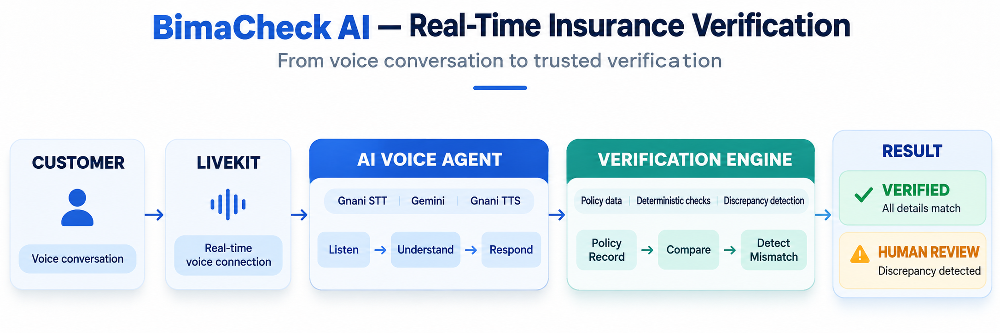
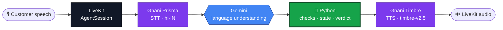
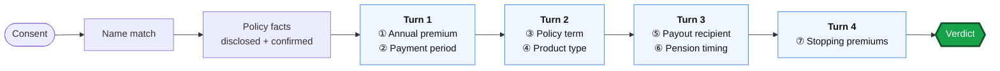

<div align="center">

# 🛡️ BimaCheck AI

### Voice-based insurance policy verification where **Python decides** and **Gemini only listens**

<br>


<br>



</div>

<br>

## ⚡ The Pipeline



> **Gemini interprets and proposes wording. Python alone owns the current question, state, evidence, policy comparisons, discrepancies, safety decisions, and the final verdict.** Gemini cannot pass a check or advance the workflow.

<br>

<table>
<tr>
<td width="33%" valign="top">

### 🧠 Gemini does
- Understands Hindi and Hinglish
- Proposes spoken wording
- Suggests an interpretation

**Never** verifies, passes, or advances.

</td>
<td width="33%" valign="top">

### 🐍 Python does
- Owns check ID and state
- Compares against the policy record
- Records discrepancies
- Runs safety rules
- Issues the verdict

**Always** uses the original transcript.

</td>
<td width="33%" valign="top">

### 🔒 Guardrails
- Name withheld from Gemini until verified
- Mandatory answers beat handoffs
- End-call needs explicit customer words
- Parse or provider failure gives a safe clarification, no retry

</td>
</tr>
</table>

<br>

## 🔍 Seven Checks, Four Turns



Each check is evaluated independently. A correct answer passes and advances. A wrong, unclear, or refused answer becomes a **discrepancy** and advances, with no second substantive attempt. Compatible fragments merge with a **0.4s** max wait, unrelated turns are buffered, and end-call language is never merged.

<br>

## 🚦 Verdicts

<table>
<tr>
<td align="center" width="33%">

### 🟢 Green
`clear`

All checks passed, no review concerns.

</td>
<td align="center" width="33%">

### 🟡 Amber
`pending_review`

Discrepancies or non-critical review conditions.

</td>
<td align="center" width="33%">

### 🔴 Red
`hold`

Refused consent, or confirmed guarantee or sign-pressure risk.

</td>
</tr>
</table>

<br>

<table>
<tr>
<td width="50%" valign="top">

## 📋 Demo Policy Record

| Fact | Value |
|:--|:--|
| **Product** | Suraksha Pension Plus (deferred annuity) |
| **Annual premium** | ₹1,50,000 |
| **Payment period** | 10 years |
| **Policy term** | 20 years |
| **Payout recipient** | Sunita |
| **Payout starts** | After 5 years |
| **If premiums stop** | Policy may lapse or benefits may reduce |

<sub>The 5-year payout start is separate from the 10-year payment period.</sub>

</td>
<td width="50%" valign="top">

## 🇮🇳 Built for Indian Speech

| Input | Understood as |
|:--|:--|
| `₹1,50,000` | 150000 |
| `150000` | 150000 |
| `डेढ़ लाख` | 150000 |
| `Sunita` / `सुनीता` | Recipient match |
| `Vansh` / `वंश` | Name match |

<sub>Indian comma grouping, currency prefixes, and Hindi/Hinglish number words are normalized. Name matching is case-insensitive substring, not fuzzy phonetics.</sub>

</td>
</tr>
</table>

<br>

<table>
<tr>
<td width="50%" valign="top">

## 🧰 Stack

| Layer | Tech |
|:--|:--|
| Runtime | Python 3.11 (3.11.9) |
| Orchestration | `livekit-agents==1.8.10` |
| Speech | `livekit-plugins-gnani==1.8.10` |
| STT | Gnani Prisma streaming, `hi-IN` |
| TTS | Gnani Timbre `timbre-v2.5`, WebSocket |
| LLM | `google/gemini-3.5-flash-lite` via LiveKit Inference |
| LLM config | Low reasoning, 8s timeout, no retry |
| Policy | JSON record + deterministic evaluators |
| Tests | pytest |

</td>
<td width="50%" valign="top">

## 📈 Observability and Tests

Monotonic logs across every stage:

`Final STT` → `Gemini request/response` → `Python evaluation` → `TTS request/start` → `Playback done or interrupted`

<br>

| Suite | Result |
|:--|:--|
| Full |  |
| Voice, policy, compliance |  |

<sub>`TOTAL_TO_FIRST_AUDIO_MS` reports `unavailable`, since first-audio onset is not reliably measurable.</sub>

</td>
</tr>
</table>

<br>

<details>
<summary><b>🔬 Gemini boundary, in detail</b></summary>

<br>

- The prompt and schema describe **ten fields**. The parser requires a non-empty `spoken_response` and a valid `intent`, defaults the rest, ignores extra top-level fields, and rejects invalid enums, types, or tool shapes.
- Python pins the check ID and the original transcript. Gemini's candidate is interpretation only, never verification evidence.
- A proposed handoff cannot override a current mandatory answer.
- Risk signals are checked by Python against approved patterns.

</details>

<details>
<summary><b>🛠️ Key implementation highlights</b></summary>

<br>

Deterministic identity routing · Python-owned check state and verdicts · suppression of Gemini-directed transitions · corrected handoff precedence · Hindi/Indian-number and recipient matching · four-turn aggregation with bounded waiting · one-pass discrepancy handling · tolerant Gemini response parsing · turn-level latency instrumentation

</details>

<details>
<summary><b>🧪 Run the tests</b></summary>

<br>

```bash
pip install livekit-agents==1.8.10 livekit-plugins-gnani==1.8.10 pytest
pytest
```

</details>

<br>

<div align="center">

**Scope:** this repo contains the voice agent only. No database, backend, or frontend.

<sub>Built by Vansh</sub>

</div>